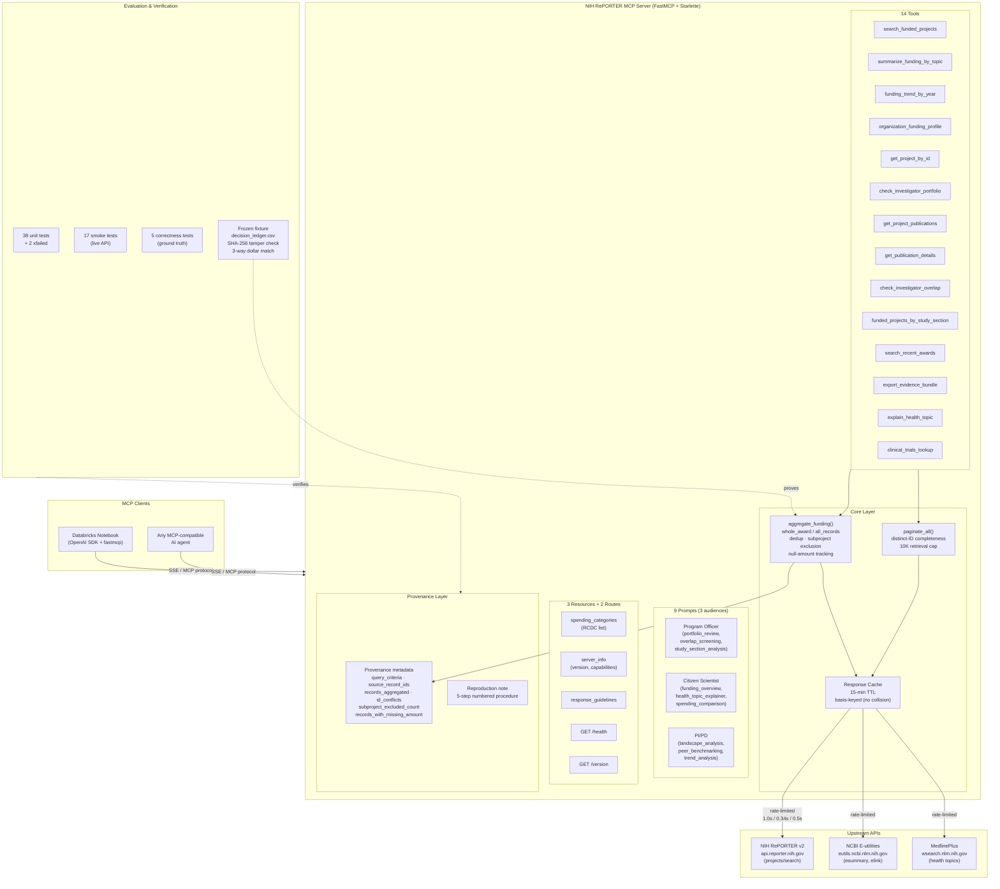

# Architecture

## System Overview

## Key Design Decisions

| Decision | Rationale |
|---|---|
| **whole_award as default basis** | Prevents double-counting when a multi-project grant’s parent and subprojects are both retrieved (U19AG068753 fixture). For CRISPR FY2023, all_records exceeds whole_award by 10.1%: a basis difference, not all duplication (166 orphan subprojects) |
| **Provenance on every dollar figure** | Every total carries the exact query, contributing appl_ids, and a reproduction procedure |
| **Basis-keyed cache** | 15-minute TTL; whole_award and all_records are cached independently (no collision, proven by t18) |
| **Rate limiting per upstream** | RePORTER 1.0s, E-utilities 0.34s, MedlinePlus 0.5s — respects API terms of service |
| **10,000-record retrieval cap** | Paginator fetches up to 20 pages × 500; `complete=False` flagged honestly when cap is hit |
| **Audience-tailored prompts** | Same data, different framing: program officer (oversight), citizen scientist (accessibility), PI/PD (benchmarking) |
| **Frozen demonstration fixture** | SHA-256-hashed raw data + decision ledger + independent hand calculation — proves correctness is not aspirational |
